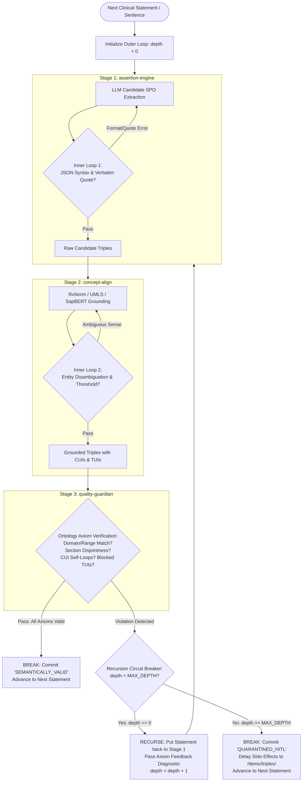
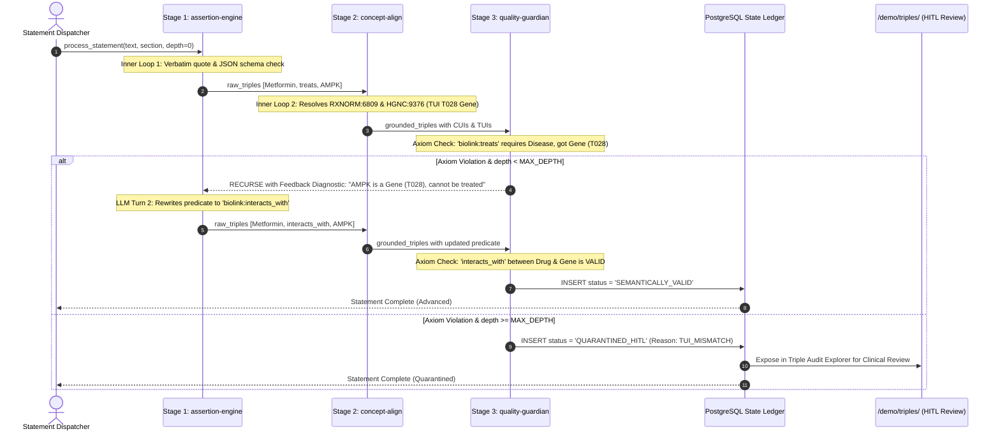
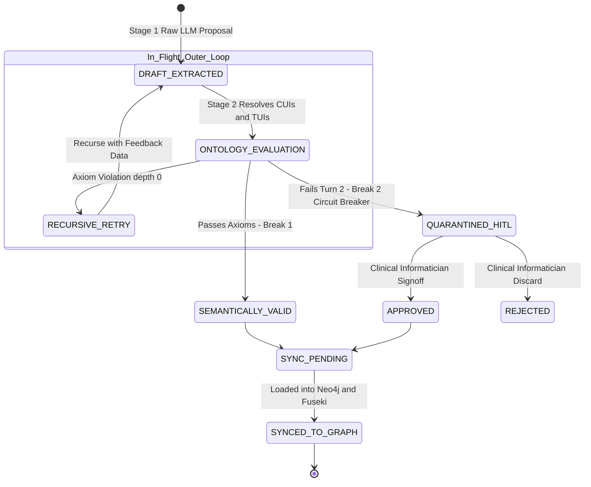

# Architectural Reference: Moving Beyond the Waterfall with Neurosymbolic State-Machine Governance
**Subtitle:** Operationalizing Frank Coyle's "Ontologies for Agentic Systems" in REAL-KG / RWDKN via Hierarchical Inner Loops and Recursive Break Control  
**Date:** October 14, 2026 • 21:35 EDT  
**Version:** 2.1.0 (Hierarchical Statement Recursion)  
**Status:** Approved Architectural Blueprint  
**Authors:** REAL-KG Architecture & Core BioNLP Engineering Team  
**Reference Video / Paper:** Frank Coyle (UC Berkeley), *"Why Agentic Systems Need Ontologies: Bridging LLMs, In-The-Loop Validation, and Neurosymbolic AI"*, AI Engineer World's Fair 2026 ([Talk Link](https://ai.engineer/talks/Sir59K8ZDPU-ontologies-for-agentic-systems))

---

## 1. Executive Summary

As the REAL-KG / RWDKN knowledge ecosystem expands from batch processing (DailyMed SPL, PubMed TiAb, FAERS) into real-time clinical querying and agentic pharmacovigilance workflows, its historical **file-based waterfall pipeline** creates significant operational friction. 

Currently, extractions pass through a sequential cascade of isolated CLI scripts (`source-nexus` $\rightarrow$ `assertion-engine` $\rightarrow$ `concept-align` $\rightarrow$ `biolink-bridge` $\rightarrow$ `quality-guardian`). In this model:
1. **Validation is post-hoc**: Ontological and semantic rules are enforced hours later in downstream gating scripts (`validate_contracts.py`), discarding invalid triples long after the LLM extraction context has expired.
2. **Latencies are all-or-nothing**: Ingesting a single new drug label or five PubMed abstracts requires executing the full batch cascade.
3. **Clinical auditability is fragmented**: Intermediate files on disk (`application/kg-data/`) must be manually audited rather than queried via structured database transactions.

### The Architectural Upgrade
To eliminate the waterfall while preserving 100% of existing BioNLP models, ontologies, and storage tiers, REAL-KG adopts **Path 3 (Database State-Machine & Audit Ledger via PostgreSQL)** orchestrated through a **Hierarchical Statement-Level Control Loop**:
- **Inner Loop 1 (`assertion-engine`)**: Verifies JSON syntax, required fields, and verbatim evidence quotes.
- **Inner Loop 2 (`concept-align`)**: Handles fuzzy entity disambiguation and Tier 0-3 resolution to RxNorm, SNOMED, and UMLS TUIs.
- **Stage 3 Evaluation (`quality-guardian`)**: Evaluates the grounded assertion against formal Biolink ontology axioms (domain/range, section disjointness, CUI self-loops, and blocked TUIs).
- **The Outer Recursive Loop**: If Stage 3 detects a violation, the statement **recurses back to Stage 1** with explicit diagnostic feedback (e.g., *"AMPK was resolved to a Gene (T028), which cannot be 'treated' by a drug"*).
- **Recursion with Break (Circuit Breaker)**: Bounded at `MAX_RECURSION_DEPTH = 1`. If an assertion fails a second time, recursion breaks and commits the triple to PostgreSQL as `QUARANTINED_HITL` for human review in the Triple Audit Explorer (`/demo/triples/`), shielding the live graph from unverified data.

---

## 2. Theoretical Grounding: Frank Coyle's 5 Principles

```
       ┌────────────────────────────────────────────────────────┐
       │             Frank Coyle's Neurosymbolic Model          │
       └────────────────────────────────────────────────────────┘
                 System 1 (LLM)  ◄───►  System 2 (Ontology)
              [Probabilistic/Fast]     [Deterministic/Formal]
                        │                         │
                        ▼                         ▼
                 Candidate Triple        Axiom Verification
               (Metformin, treats,        Domain/Range, TUI,
                     Nausea)              Section Disjointness
                        │                         │
                        └───► [Conflict!] ◄───────┘
                                   │
                                   ▼
                      In-The-Loop Reflection
                    "Nausea is an adverse event,
                       not a therapeutic target"
                                   │
                                   ▼
                            Corrected Triple
                       (Metformin, has_adverse_event,
                                   Nausea)
```

| Coyle Principle | Core Definition | REAL-KG Application |
| :--- | :--- | :--- |
| **1. Neurosymbolic Dual-Process** | Pair System 1 generative LLMs with System 2 deterministic knowledge models (Biolink, UMLS, SNOMED, RxNorm). | The LLM proposes candidate triples; the ontology strictly dictates allowed predicates, domain/range constraints, and qualifiers. |
| **2. Structural vs. Semantic Validation** | Pydantic / JSON Schema validates syntax and types; ontologies validate real-world domain truth and relation semantics. | A candidate triple like `(Metformin)-[:treats]->(Nausea)` is 100% valid JSON/Pydantic, but violates biomedical ontology semantics when sourced from `ADVERSE REACTIONS`. |
| **3. In-The-Loop Reflection** | Validation must execute immediately after candidate proposal, inside the generation loop, allowing the model to self-correct. | Catch domain-range and section violations in memory; prompt the LLM with the exact axiom violation while document context is hot. |
| **4. Delay of Side-Effects & Quarantine** | Never commit unverified or ambiguous assertions to live production graphs. | Assertions stage in PostgreSQL. Ambiguous or borderline extractions route to a Human-in-the-Loop (HITL) quarantine in `/demo/triples/`. |
| **5. Ontology-Guided Querying** | Natural Language Query (NLQ) agents translating intent into Cypher/SPARQL must be bounded by the ontology schema. | Cypher ASTs are pre-validated against allowed node labels and relationship directions before hitting Neo4j. |

---

## 3. The Hierarchical Loop Architecture (CLEAR DIAGRAMS)

### 3.1. Statement-Level Control Loop with Circuit Breakers



### 3.2. Inter-Stage Sequence & Dataflow Diagram



---

## 4. Python Implementation: Recursion with Break Pattern

```python
MAX_RECURSION_DEPTH = 1  # 1 initial pass + 1 reflective retry turn

def process_statement(statement_context: dict, feedback: dict = None, depth: int = 0):
    """
    Hierarchical Statement Processor:
    - Inner loops guarantee local syntactic & normalization correctness.
    - Outer loop guarantees global ontological truth with recursive circuit breaker.
    """
    # -------------------------------------------------------------------
    # STAGE 1: assertion-engine (Inner Loop 1: Syntax & Quote Match)
    # -------------------------------------------------------------------
    candidate_triples = assertion_engine_inner_loop(
        statement=statement_context["text"],
        section=statement_context["section"],
        feedback=feedback  # Contains diagnostic if depth > 0
    )
    if not candidate_triples:
        return {"status": "NO_ASSERTIONS"}

    # -------------------------------------------------------------------
    # STAGE 2: concept-align (Inner Loop 2: Entity Disambiguation)
    # -------------------------------------------------------------------
    grounded_triples = concept_align_inner_loop(candidate_triples)

    # -------------------------------------------------------------------
    # STAGE 3: quality-guardian (Ontology Axiom Verification)
    # -------------------------------------------------------------------
    audit_results = quality_guardian_verify(grounded_triples, statement_context)

    # ===================================================================
    # THE OUTER LOOP: BREAK OR RECURSE
    # ===================================================================
    if audit_results.is_valid:
        # BREAK 1: SUCCESS -> Commit and move to next statement
        save_to_postgres(grounded_triples, status="SEMANTICALLY_VALID")
        return {"status": "SUCCESS", "depth": depth}

    # If ontology violation occurred:
    if depth < MAX_RECURSION_DEPTH:
        # RECURSE: Feed the exact ontology diagnostic back to Stage 1
        reflection_feedback = {
            "prior_attempt": candidate_triples,
            "violations": audit_results.violations,
            "instruction": audit_results.correction_advice
        }
        return process_statement(statement_context, feedback=reflection_feedback, depth=depth + 1)
    else:
        # BREAK 2: CIRCUIT BREAKER -> Delay side-effects (HITL Quarantine)
        save_to_postgres(grounded_triples, status="QUARANTINED_HITL", violations=audit_results.violations)
        return {"status": "QUARANTINED", "reason": audit_results.violations}
```

---

## 5. Assertion State-Machine Lifecycle



### PostgreSQL Schema Extension

```sql
-- Migration: Add Neurosymbolic Lifecycle to pipeline_assertions
ALTER TABLE pipeline_assertions
  ADD COLUMN IF NOT EXISTS lifecycle_status VARCHAR(32) NOT NULL DEFAULT 'DRAFT_EXTRACTED',
  ADD COLUMN IF NOT EXISTS ontology_violations JSONB DEFAULT '[]'::jsonb,
  ADD COLUMN IF NOT EXISTS recursion_depth INT DEFAULT 0,
  ADD COLUMN IF NOT EXISTS grounding_score NUMERIC(4,3),
  ADD COLUMN IF NOT EXISTS reviewed_by VARCHAR(64),
  ADD COLUMN IF NOT EXISTS reviewed_at TIMESTAMPTZ,
  ADD COLUMN IF NOT EXISTS review_notes TEXT;

-- Enforce valid lifecycle transitions
ALTER TABLE pipeline_assertions
  ADD CONSTRAINT chk_lifecycle_status CHECK (
    lifecycle_status IN (
      'DRAFT_EXTRACTED',
      'ONTOLOGY_VALIDATED',
      'QUARANTINED_HITL',
      'APPROVED',
      'REJECTED',
      'SYNCED_TO_GRAPH'
    )
  );

CREATE INDEX IF NOT EXISTS idx_assertions_lifecycle 
  ON pipeline_assertions(lifecycle_status, grounding_score);
```

---

## 6. Operationalizing the HITL Quarantine in `/demo/triples/`

Under this hierarchical architecture, the **Triple Audit Explorer** ([`docker/explorer/sentences/index.html`](file:///home/chandrakola/development/NLM/kg/rwdkn-service/docker/explorer/sentences/index.html) and `/demo/triples/`) becomes an active **Clinical Review Workbench**:

1. **Quarantine Queue View**: Clinicians filter by `lifecycle_status = 'QUARANTINED_HITL'`.
2. **Diagnostic Badges**: Each quarantined triple displays its exact ontology violation:
   - `[Badge: Section Mismatch]`
   - `[Badge: Low Grounding (0.76)]`
   - `[Badge: CUI Self-Loop]`
   - `[Badge: TUI Blocked (T185)]`
3. **One-Click Actions**:
   - **Approve**: Sets `lifecycle_status = 'APPROVED'`, stamps `reviewed_by = 'dr_mehmet'`, and queues for graph materialization.
   - **Edit & Approve**: Allows the clinician to change the predicate (e.g., `treats` $\rightarrow$ `has_adverse_event`) and approve.
   - **Reject**: Sets `lifecycle_status = 'REJECTED'`, preventing graph leakage while retaining audit history.

---

## 7. Ontology-Constrained Cypher Guard for NLQ (`query-app`)

In [`cypher_generation.py`](file:///home/chandrakola/development/NLM/kg/rwdkn-data-pipeline/subprojects/query-app/query_translator/cypher_generation.py), before dispatching an LLM-generated Cypher query to Neo4j, we insert an **Ontology Metamodel Pre-Flight Guard**:

1. **Valid Edge Traversal Direction**: 
   - `(:Drug)-[:TREATS]->(:Disease)` is permitted.
   - `(:Disease)-[:TREATS]->(:Drug)` is flagged as reversed before execution.
2. **Valid Predicate Vocabulary**: 
   - Prohibits hallucinated Cypher relationship types (e.g. `[:CAUSES_SIDE_EFFECT]` is rejected with advice to use `[:HAS_ADVERSE_EVENT]`).
3. **Property Key Integrity**: 
   - Verifies that `WHERE` and `RETURN` clauses query standardized KGX attributes (`p.subject`, `p.predicate`, `p.grounding_score`, `p.source_type`).

---

## 8. Implementation Roadmap (Phased & Low-Risk)

```
Phase 1 (Week 1): PostgreSQL State Ledger Schema
├── Add lifecycle_status, ontology_violations, recursion_depth columns
└── Index state transitions for fast queuing

Phase 2 (Week 2): Hierarchical Statement Control Loop
├── Implement process_statement recursion with break
├── Connect Stage 1, Stage 2, and Stage 3 with circuit breaker
└── Route 2nd-turn failures to 'QUARANTINED_HITL' in PostgreSQL

Phase 3 (Week 3): Triple Audit Explorer HITL Integration
├── Expose /api/quarantine endpoint in rwdkn-service
├── Render violation badges in /demo/triples/ UI
└── Implement Approve/Reject/Edit action handlers

Phase 4 (Week 4): Live Graph Sync & Cypher Guard
├── Decouple load_kgx_to_neo4j.py to read only 'APPROVED' / 'VALIDATED' records
└── Add Cypher AST schema validation in query-app
```

---

## 9. Conclusion

Moving beyond the waterfall does not require a disruptive overhaul or complex streaming infrastructure. By adopting **Path 3 (Database State-Machine & Audit Ledger)** with **Hierarchical Statement Loops and Recursive Break Control**, REAL-KG:
1. **Directly fulfills Frank Coyle's neurosymbolic vision**: Putting deterministic ontologies in the loop with generative LLMs.
2. **Guarantees clinical data integrity**: Completely isolating Neo4j and Fuseki from unverified extractions.
3. **Prevents infinite loops & token burn**: The recursive circuit breaker guarantees execution terminates in at most 2 turns.
4. **Empowers clinicians with an actionable HITL workbench**: Transforming `/demo/triples/` from a passive viewer into a certified audit control center.
5. **Preserves existing investments**: Reusing the existing PostgreSQL database, LinkML schemas, and Airflow schedulers with zero architectural waste.
